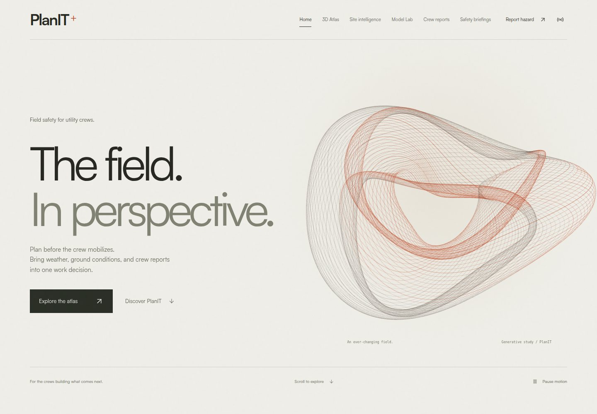
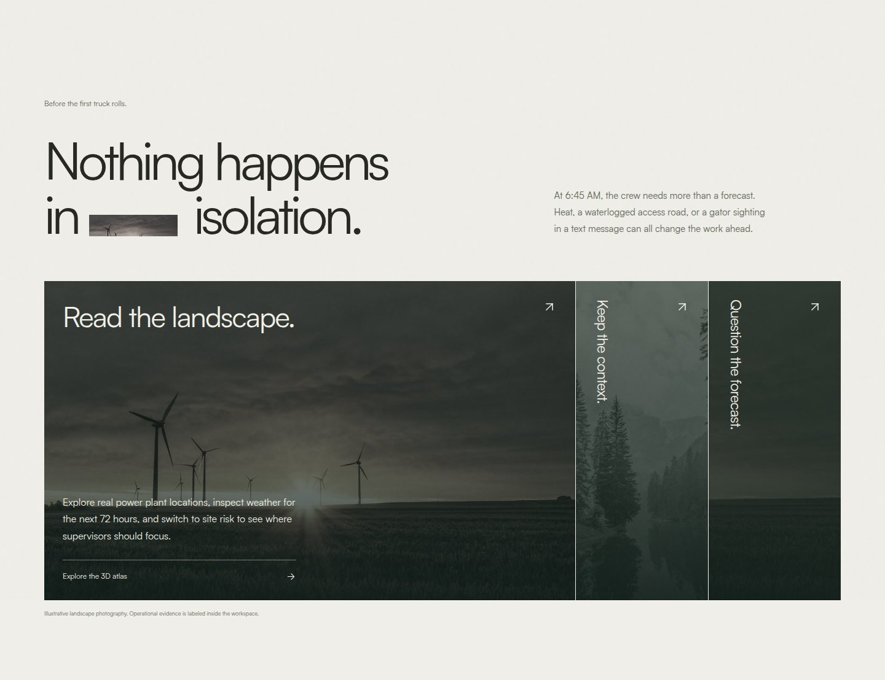
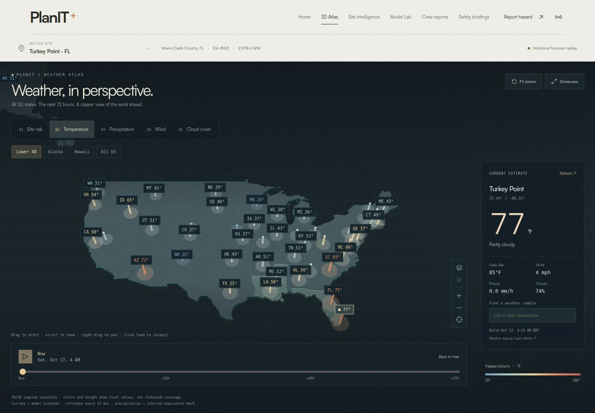
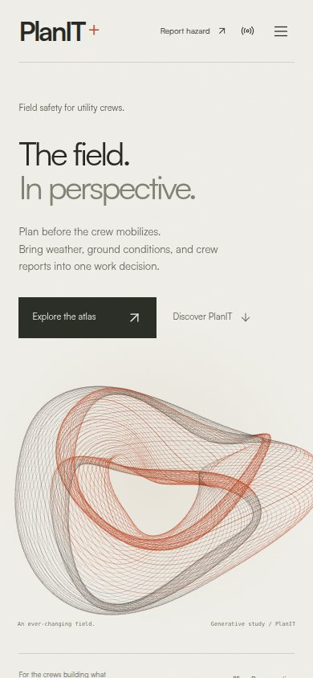

# PlanIT Control: frontend case study

**Iteration:** editorial website with a dedicated fullscreen atlas  
**Audit date:** October 17, 2026  
**Challenge:** user-supplied text from `PlanIT_Control_SwampHacks_Brief.docx`, PlanIT Control / Sperry Tech  
**Scope:** current implementation summary plus the original visual-design audit. Browser captures and manual UX findings below predate the canonical risk-atlas migration; they are retained as historical design evidence, not refreshed captures.

## The problem behind the interface

The brief starts at 6:45 AM on an August construction shift in the Everglades. A crew needs to mobilize equipment for a transmission-line project. Heat will build by noon, thunderstorms are approaching, the access road is wet, and yesterday’s wildlife sighting is buried in a text conversation.

The design problem is how to get those different kinds of evidence into the same work decision. A forecast cannot replace a crew’s observation. A wildlife report cannot establish tomorrow’s weather. An unknown channel cannot be treated as safe.

PlanIT Control organizes that work around real power plant locations used as demonstration job sites. Its interface supports a supervisor reviewing restrictions and a crew member contributing location-specific knowledge. It does not establish that these plants are active construction projects or that its policies are ready for operational deployment.

## The iteration being preserved

The user identified this frontend as the strongest iteration so far. This pass preserves its layout, artwork, typography, navigation, and motion. The later backend/map work preserves this visual identity while replacing the independent weather path with canonical risk frames, evidence inspection and confidence-aware ranking.

The website opens with an editorial page. A generative field-line sculpture accompanies a two-line headline, **“The field. In perspective.”** Satoshi typography, warm paper surfaces, copper accents, straight edges, and substantial spacing establish the visual language. The homepage avoids a grid of dashboard statistics or rounded feature cards.

The interactive atlas has its own URL and fills the viewport beneath navigation and site selection. It is not mounted behind the homepage. Site ranking and work decisions belong to a separate Site intelligence page. This separation follows the user’s requested design direction and keeps the opening experience independent of the map renderer. The atlas now opens on Site risk and renders all 285 plants from `/api/risk/atlas`. Eleven measurement/risk layers and the 72-hour slider use the same backend snapshot pipeline. Arbitrary-point weather requests and statewide weather samples are no longer map consumers.

The design references used in this iteration are [Lusion](https://www.awwwards.com/sites/lusion), for real-time abstract imagery, and [Active Theory V6](https://www.awwwards.com/sites/active-theory-v6), for open typography and immersive navigation. The sculpture is original canvas artwork. Reference-site imagery is not bundled.

### Browser captures

These captures show the original editorial copy/design iteration, before the canonical atlas migration. The atlas image retains superseded weather controls; use the current code and automated risk-atlas tests for present behavior. They use reduced motion so the sculpture and scroll text remain stable. Standard motion includes the animated sculpture, marquee, pinned story heading, and scrubbed word reveals. Weather and safety values in the atlas are application/provider state, not verified on-site observations. No weather fixtures were injected for these captures.

## From brand language to a useful explanation

The approved headline remains. The surrounding copy now explains who the product serves and what someone can actually do with it.

| Surface | Existing homepage/working-view copy | Purpose |
| --- | --- | --- |
| Hero introduction | “Field safety for utility crews.” | Identify the audience immediately. |
| Hero description | Plan before mobilization; bring weather, ground conditions, and crew reports into one work decision. | Connect the artwork and brand to field work. |
| Opening narrative | A 6:45 AM shift, a waterlogged road, and a wildlife sighting in a text message. | Use the brief’s scenario without presenting it as a recorded event at a plant. |
| Atlas feature | Inspect real plant locations and the next 72 hours of weather; switch to site risk for supervisor attention. | This homepage sentence predates the risk-first atlas; updating it is a remaining copy task, not a second data path. |
| Crew feature | Pin a photo report, hold affected tasks, and preserve a record for the next crew. | Describe the report’s operational consequence. |
| Model feature | Inspect HeatCast and GroundCast estimates and try local calibration separately from operational models. | Explain the models without inventing a universal safety predictor. |
| Hazard explanation | Review seven evidence channels; missing or stale coverage stays unknown. | Prevent a low visible score from implying complete coverage. |
| Lightning explanation | In replay, each qualifying strike within 10 miles restarts a 30-minute outdoor-work hold. | State the rule while keeping simulation explicit. |
| Handoff explanation | PlanIT creates a next-day briefing at 6 PM local time with unresolved reports, restrictions, source, and coverage details. | Describe stored briefings without promising email or SMS delivery. |
| Footer | PlanIT Control / Sperry Tech; SwampHacks field-safety prototype. | Preserve the supplied challenge identity and prototype scope. |

The copy does not claim that soil moisture determines road bearing capacity, that wildlife can be forecast automatically, or that all seven hazards have live national coverage. It avoids asserting accuracy or injury reduction that has not been established by the implementation.

## Information architecture and field workflows

| View | URL | Role in the shift |
| --- | --- | --- |
| Home | `/` | Explain the problem and direct visitors into the working tools. |
| 3D Atlas | `/?view=atlas` | Inspect all plants through canonical current/forecast frames, raw and scored layers, confidence, evidence, tasks and overrides. |
| Site intelligence | `/?view=intelligence` | Rank sites, read the selected plant’s hazard evidence, and inspect task restrictions and forecast windows. |
| Model Lab | `/?view=lab` | Inspect eligible historical-model forecasts, run browser inference, and test local calibration. |
| Crew reports | `/?view=reports` | Manage reporting teams, submit photo/pin evidence, review open reports, and preserve resolution history. |
| Safety briefings | `/?view=briefings` | Read and download the selected plant’s stored next-day handoffs. |

A supervisor can move from the atlas to Site intelligence without losing the selected plant. A crew member can open the report form from any view. Reports apply selected task holds after server acceptance and update other connected screens. A resolved report remains in history and cannot clear an independent lightning or environmental hold.

Native links support new tabs and query-string view navigation. Reloads and browser Back retain the view. Plant selection is remembered on the device; it is not currently encoded in shareable links.

## Coverage against the challenge brief

“Implemented” here means the behavior exists in this local prototype. It does not mean a live provider is always available or that field-safety performance has been validated.

| Brief requirement | Current implementation | Remaining boundary |
| --- | --- | --- |
| At least 50 actual plant locations | 285 EIA plant locations across all 50 states. | These are demonstration site locations. Historical custom-model coverage remains the original 50-plant cohort. |
| One combined risk picture across seven hazards | Seven channels show evidence, unknown coverage, a composite index, and task restrictions. | Every site shares normalization and scoring, with provider failures kept unknown. Model availability is separate from environmental coverage; this is not national custom-model validation. |
| Instant dangerous-condition alerts | Server events refresh connected browsers after changes; holds and countdowns are visible in the workspace. | External feeds poll on schedules. There is no guaranteed instantaneous detection or out-of-browser emergency notification delivery. |
| Lightning within 10 miles; 30-minute reset | The shared distance/countdown policy supports live detected events and separately labeled replay; the current inspector renders live overrides. | No licensed live network is configured. Demo events stay outside live risk; recorded mode only reads already trusted live events. |
| Flood warnings after heavy rain near rivers | Live flood scoring combines available rainfall, USGS stage/trend/rolling abnormality, FEMA static exposure and NWS alerts. | Nearby gauges do not verify hydrologic connectivity. FEMA exposure is static; rolling abnormality is not a flood probability or forecast inundation. |
| Wildfire and wildlife coverage | NWS red flags, credential-gated FIRMS thermal anomalies, crew reports and filtered public iNaturalist context contribute independent evidence. | FIRMS authenticated access remains unverified without a key; anomalies are not fire perimeters. Public wildlife observations are sparse context, not dangerous-encounter predictions. |
| A next-day report at 6 PM local time | The running server generates one stored briefing per site/date, carries unresolved reports, and supports download. | The Node process must remain running. The prototype creates briefings inside the application; it does not email or text them. |
| Photo, map pin, shared site memory | Photo upload, geographic pinning, persistent reports, team assignments, affected-task holds, and resolution history work. | The database and uploads belong to this local deployment, not a public cross-owner service. Complete offline report synchronization is not implemented. |
| Supervisor map and risk ranking | The atlas and priority list use canonical current risk. Holds lead ranking, significant risk follows, and insufficient evidence precedes observed low risk. Selection is shared. | Map and ordered list remain on different views. The atlas opens on Site risk; period-labeled model/replay detail views retain their own periods. |
| ML-trained hazard index from historical data | HeatCast and GroundCast are trained environmental models with exported evaluation and browser inference. Their outputs inform policy screening. | The 0 to 10 index uses deterministic continuous channel scoring and dominant-plus-compounding aggregation, separate from task policy. It is not a learned seven-hazard injury-risk model. GroundCast targets reanalysis soil moisture, not observed vehicle immobilization. |

The optional resources in the brief are suggestions. This case study does not imply that NOAA Storm Events, OSHA injury records, FEMA training labels, NLD boreholes, or tide stations have been integrated into model training. The implemented sources and limitations are recorded in [Data and policies](data-and-policies.md), [Models](models.md), and [Verified data sources](verified-data-sources.md).

## What the frontend does well

- **Opening hierarchy:** the short headline and crew-specific introduction explain the product without replacing the approved visual treatment. Browser measurements retain two headline lines at desktop and mobile widths.
- **Purposeful view separation:** the homepage explains the product; the atlas provides a dedicated spatial workspace; Site intelligence supplies ranking and work decisions.
- **Evidence visibility:** historical replay, live forecasts, simulated strikes, crew observations, stale data, and missing coverage remain distinguishable. The decorative sculpture and landscape photographs are labeled separately from operational evidence.
- **Accessible foundations:** native navigation links, labeled controls, visible focus styling, a skip link, keyboard feature selection, and headings are present. Ambient motion has a pause control. Reduced motion removes pinning, scrubbing, and automatic movement while keeping the content visible.
- **Offline honesty:** cached model inference and local training work with prepared assets. The interface does not promise offline report delivery or server scheduling in a disconnected browser.
- **Scoped rendering:** the national Three.js scene is lazy loaded for atlas use; TensorFlow browser code remains a lazy Model Lab boundary. The hero canvas pauses offscreen and in hidden tabs and disposes its observers and animation frame.

These are implementation and browser observations. There has been no formal study with utility crews, no outdoor/gloved-use trial, and no measured reduction in accidents or decision time.

## Remaining audit findings

This is a focused source and browser audit, not an exhaustive WCAG conformance assessment. The audit uses the [Web Interface Guidelines](https://raw.githubusercontent.com/vercel-labs/web-interface-guidelines/main/command.md) for interaction, accessibility, animation, content, and navigation checks. The findings below were recorded during the original manual browser audit and were not re-audited by the backend/map implementation or this documentation pass. Passing workflow tests does not close them.

### P1: report dialog does not manage keyboard focus

`src/features/reports/Reports.tsx` - `aria-modal="true"` is present, but focus is not moved into the dialog, contained within it, or restored explicitly. Escape has no report-close handler. In Chrome inspection, opening the form left focus on the header’s Report hazard button. The next Tab moved to the background Demo controls button, and Escape left the report dialog open.

**Effect:** a keyboard user can continue into background controls while a modal is displayed. A visible Close button and backdrop click do not provide complete modal behavior.

**Next change:** use a tested dialog primitive or implement initial focus, focus containment, Escape dismissal, and trigger-focus restoration. Preserve form drafts and task selection when closing.

### P1: geographic pin placement requires a pointer

`src/components/site-map/FlatMap.tsx` - fallback pin placement is click-only. `src/features/reports/Reports.tsx` - the form exposes coordinates as text and supplies a pointer-driven `onPin` callback, without coordinate-entry fields or a keyboard placement alternative.

**Effect:** accessible camera buttons and keyboard-selectable plant beacons do not let a keyboard-only user place a hazard at an arbitrary location.

**Next change:** offer labeled latitude/longitude inputs or a keyboard-movable pin with an announced position, using the same coordinate validation and projection rules as pointer placement.

### P2: small art captions have insufficient normal-text contrast

`src/styles/site.css` - the art caption uses `#757565` at 8px on desktop, dropping to 7px on mobile. Against the plain `#efeee8` page color, its calculated contrast is approximately **4.02:1**, below the [4.5:1 minimum for normal text](https://www.w3.org/WAI/WCAG22/Understanding/contrast-minimum.html). The radial artwork background may change the local ratio; this calculation is not a pixel-by-pixel contrast map.

**Next change:** darken the caption and review its size without changing the composition. Larger hero text uses a different color and passes the corresponding large-text contrast threshold in the sampled base-color calculation.

### P2: operational microcopy needs field-use validation

`src/styles/site.css` - active-site labels and several secondary source/status labels use small type. Mobile rules include 8px to 11px operational text.

**Effect:** screenshot layout checks do not establish readability in glare, at enlarged text settings, or while wearing gloves. Small type alone is not a WCAG failure finding here.

**Next change:** test core source, unknown-coverage, hold, and countdown labels at larger text settings and on actual field devices before reducing information density further.

### P2: shareable links preserve the view, not the inspected state

`src/app/navigation.ts` - only `view` is read from the URL. Plant selection is stored locally; atlas layer, region, and forecast hour are component state.

**Effect:** a supervisor cannot send a link that reliably opens the same plant and risk frame on another device. A browser refresh can also reset atlas inspection state.

**Next change:** add validated URL parameters for the selected site and relevant atlas state while retaining existing local defaults.

### Product gap: the visual system must not imply complete live safety coverage

`shared/risk.ts` and `server/pipeline/normalize.ts` retain missing observations as null. The polished homepage can still create expectations beyond the connected providers if its copy becomes too broad.

**Next change:** keep the explicit lightning-replay, briefing-generation, and model-coverage wording. Treat a live strike provider, notification delivery, verified flood geography, and broader outcome validation as product work with its own acceptance evidence.

## Recommended next iteration

Keep this visual system. Prioritize complete keyboard reporting, then caption contrast and field-readable operational labels. Follow with shareable site/atlas links. Validate the supervisor journey from the risk-first atlas and channel evidence to the ordered site list with actual users.

Provider integration and notification delivery should remain separate from that design work. A new headline or map effect cannot close a missing-data or delivery requirement.

## Verification record

The original manual inspection used Chrome 153.0.8010.52 in headless mode with SwiftShader. Captures used reduced motion; automated tests also exercise the standard-motion view. These results establish browser behavior, not GPU performance or field-safety effectiveness.

| Check | Result |
| --- | --- |
| Production TypeScript and asset build | Passed through the browser suite’s build step |
| Latest implementation unit tests | 101 passed, 0 failed (`npm test`) |
| Latest implementation browser workflows | 19 passed, 0 failed (`npm run test:e2e`, 2.6 minutes) |
| Original manual browser audit | Desktop 1440 × 1000 and mobile 390 × 844; 2 hero lines at each width; page width matched viewport; no captured JavaScript page errors |
| Original pre-migration atlas bounds | At 1440 × 1000, the map started at y=149, occupied 851px of height, and reached the viewport bottom; the homepage mounted no national map canvas |
| Original modal keyboard inspection | Focus remained outside the report dialog on opening and after Tab; Escape did not dismiss it, recorded as an open P1 finding |
| Data and model artifacts | No edits in this pass |

The browser suite covers team assignments, reporting across connected screens, photo upload, pin projection, map controls and fallbacks, nationwide plant selection, canonical measurement/risk layers, timeline frames, geometry reuse, confidence/coverage, crew SSE updates and stale-cache states, loading retry, navigation history, reduced motion, reset confirmation, briefings, independent holds, browser calibration, offline inference, and mobile overflow. These counts are from the preceding implementation validation, not a new test run for this Markdown-only pass. They do not revalidate historical screenshot measurements or close the open accessibility findings above.

## Evidence and implementation references

- [Homepage composition and copy](../src/app/HomePage.tsx)
- [Working-view composition](../src/app/App.tsx) and [navigation](../src/app/navigation.ts)
- [Editorial styles](../src/styles/site.css) and [decorative field sculpture](../src/components/FieldSculpture.tsx)
- [Atlas presentation](../src/components/SiteMap.tsx) and [atlas context](../src/components/site-map/README.md)
- [Reporting form and history](../src/features/reports/Reports.tsx)
- [Canonical pipeline](environment-pipeline.md), [continuous scoring](risk-scoring.md), [provider limits](environment-providers.md), and [atlas API](api.md#authoritative-supervisor-atlas)
- [Shared hazard policy](../shared/policy.ts) and [briefing scheduler](../server/engine.ts)
- [Browser verification context](../tests/e2e/README.md)
- [Architecture](architecture.md), [model semantics](models.md), and [source/coverage limits](data-and-policies.md)
