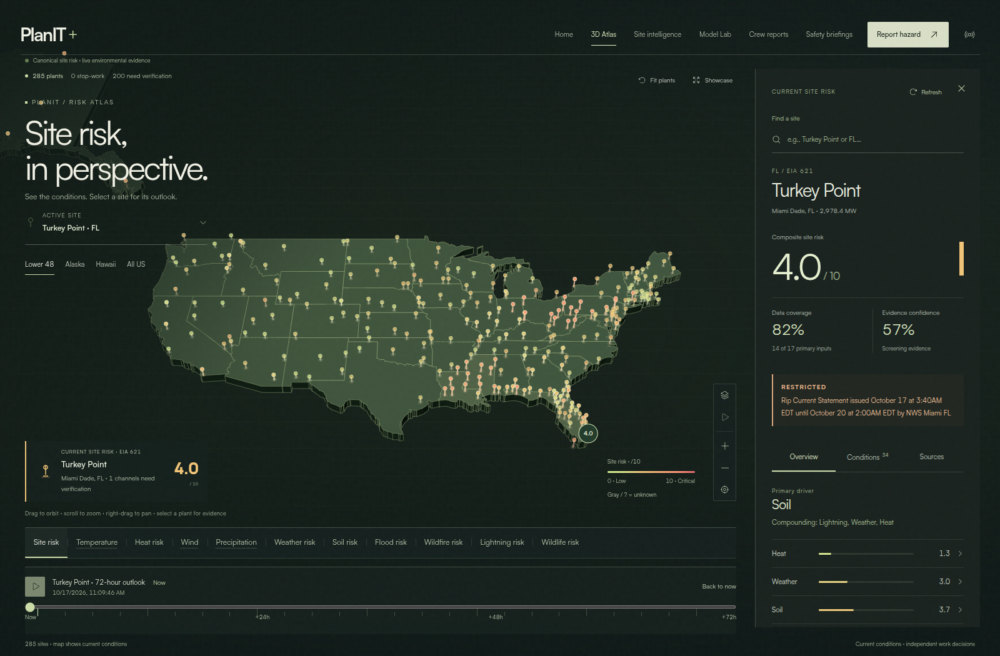
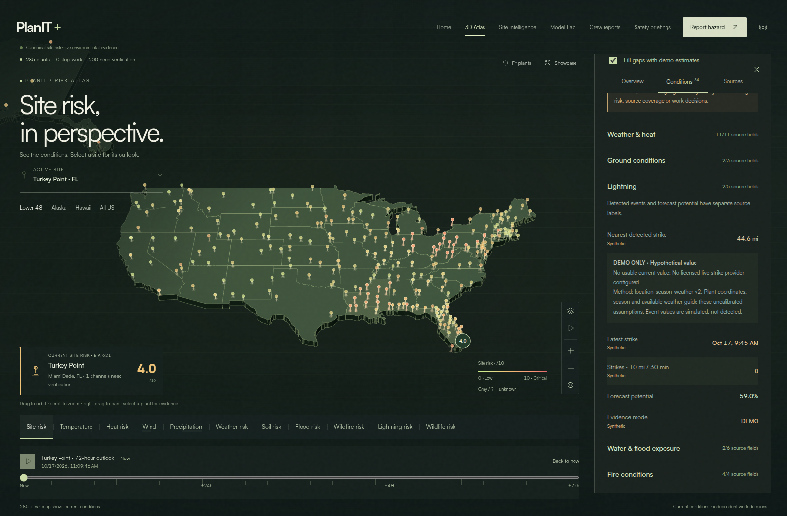

# Full-screen supervisor atlas

This frontend iteration turns `/?view=atlas` into a viewport-filling map workspace. The homepage and other working views keep their existing editorial layouts. The map still consumes the same canonical backend snapshots and demo companions.

## Layout and interaction

The Three.js canvas reaches every viewport edge. Floating navigation, site selection, region controls and the layer dock sit above it. A forecast prompt opens the selected plant’s 72-hour filmstrip; panning, zooming out or returning to a region hides the slider again. The map remains on current conditions while the inspector can show that plant’s forecast frame. The solid dark evidence drawer has straight edges and its own scroll area. Desktop opens with evidence visible; phones open with the map visible and a Site details button.

The drawer retains Overview, Conditions and Sources, including all 34 fields, risk channels, task decisions, provider health, model availability and synthetic-data labels. Its close control stays outside the scrolling contents. Closing makes hidden controls inert and returns keyboard focus to the reopen button. Reopening focuses the close control; Escape closes from inside the drawer. The selected-site summary and a new site selection also open it.

Portrait phones use a larger map framing and smaller unselected point markers. Opening evidence hides the separate site selector to prevent overlapping controls. The layer dock and timeline stay available while inspecting evidence. Compact-height layouts reduce decorative chrome. Mobile search and site-selection inputs use 16px text to avoid automatic browser zoom on focus.

## Visual system

Satoshi typography, a charcoal/olive map and restrained sage selection rules define the interface. Hazard colors retain their existing semantic scale. Navigation sits on a baseline; regions use text and underlines. Layers form one segmented text strip, with dotted labels still distinguishing raw measurements. The camera rail and forecast controls use straight edges. The opaque evidence sheet keeps map text from showing through its contents. Site locations and boundaries remain geographic; land extrusion is schematic.

The refinement references [Awwwards’ typography collection](https://www.awwwards.com/websites/typography/) and its [Terminal Industries entry](https://www.awwwards.com/sites/terminal-industries), inspected in the browser. The references inform typographic hierarchy, spacing and restrained controls; no third-party artwork or layouts are copied. Repeated pill containers, nested circular arrows and decorative metric rings were removed in response to the interface review.

The national map uses deeper state extrusion and a lower viewing angle. Desktop camera framing offsets the focal area away from the evidence drawer; report pinning retains its original camera and land depth. Adaptive near-plane precision and polygon offset remain in place.

`AtlasMotion.tsx` scopes GSAP entrances, view transitions and scroll-linked evidence prose. It cleans up animation contexts and listeners, honors reduced motion and does not animate numerical score bars. Continuous status animation changes opacity without React state updates. No post-processing passes, remote tiles or image downloads were added.

## Screenshots

Production-build captures use headless Chrome with SwiftShader and reduced motion. Desktop is 1600 × 1050; mobile is 390 × 844. They read persisted source evidence and the backend’s explicitly labeled demo companions, without browser-injected risk fixtures. Background collection was disabled in the capture process. These images establish rendering, not current provider connectivity, hardware GPU performance or field-safety effectiveness.

[Mobile map](assets/atlas-immersive-mobile.png) · [Mobile evidence drawer](assets/atlas-immersive-mobile-evidence.png)

## Verification and boundaries

The browser suite covers full-viewport rendering, floating navigation, a two-line heading, drawer focus/inert behavior, persistent close access, mobile bounds, reduced motion and existing map/report/data workflows. It also retains all-field provenance, source-only switching, forecast and independent lightning-hold checks. Exact results are recorded in [tests/README.md](../tests/README.md).

The initial regression run caught a hidden canonical source caption; it is visible again. Screenshot review also identified a non-interactive site summary, an unreachable close control after scrolling and mobile control overlaps; those were corrected and checked in the browser.

This visual change preserves the latest upstream selected-site forecast API and navigation behavior. It does not change normalized data, risk formulas, task policy, historical models or runtime records. Synthetic values remain confined to labeled condition previews. Missing operational evidence stays unknown. The existing large ML bundle warning and report-dialog accessibility findings from the [historical audit](frontend-case-study.md) remain outside this map redesign.

Manual measurement found a 1600 × 1050 renderer at (0,0) on desktop and a 390 × 844 renderer at (0,0) on mobile. Neither capture had horizontal or vertical document overflow. The inspected completion view had zero missing preview fields, and no JavaScript page errors were captured. Final focused checks also verify that the phone’s camera controls and Site details button do not overlap.
