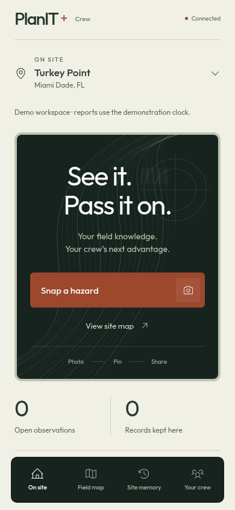
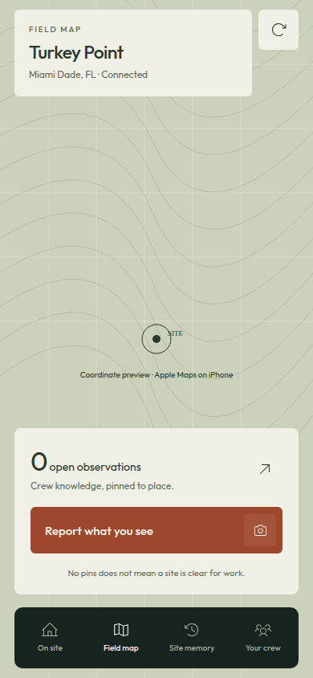
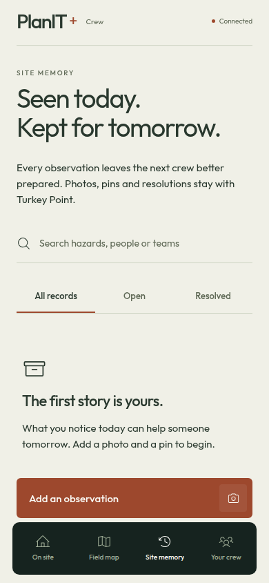
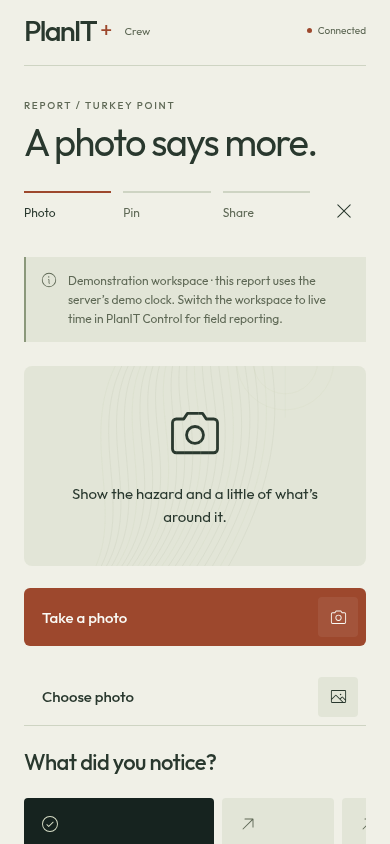
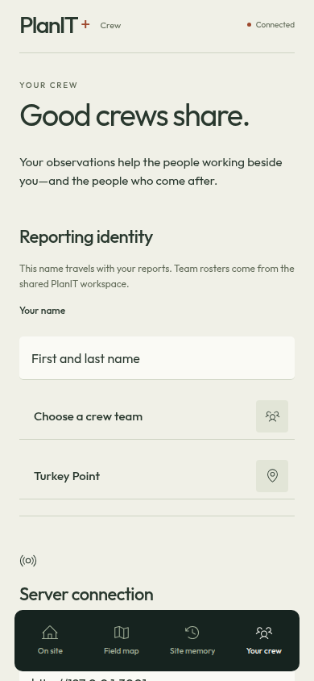
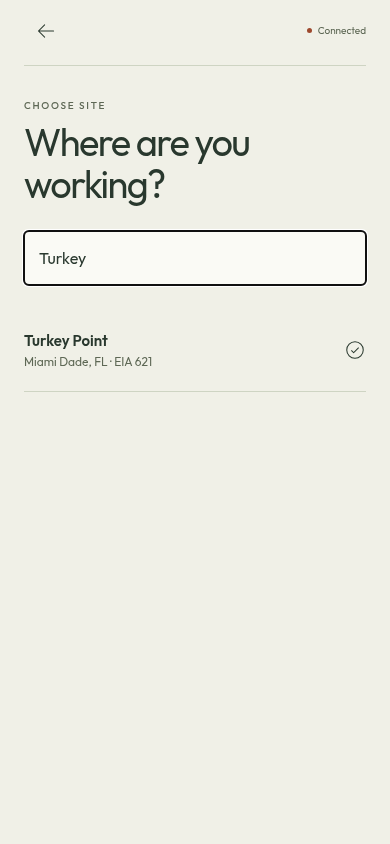

# Crew mobile UI audit

October 17, 2026. This redesign covers the Expo crew app in `mobile/`. Backend risk scoring, API contracts, crew synchronization, photo storage and draft persistence are unchanged.

## Design and references

The app carries the supervisor’s paper, olive and copper theme into a camera-first field experience. Outfit provides a rounded editorial voice; light Phosphor icons, underlined filters and flat lists replace the old pill-heavy controls. Original contour artwork frames capture without standing in for terrain, weather or hazard evidence.

References were [Awwwards’ typography collection](https://www.awwwards.com/websites/typography/), its [Terminal Industries presentation](https://www.awwwards.com/sites/terminal-industries), [typography/navigation inspiration](https://www.awwwards.com/inspiration/scroll-triggered-typography-navigation-minimal-wim), and its [Mobile Excellence guidelines](https://www.awwwards.com/mobile-excellence-guidelines.pdf). The typography and Terminal reference captures from the earlier website pass were inspected again. The mobile-design gallery timed out during this pass; it is not claimed as a reviewed reference. No third-party site artwork was copied into the app.

The requested design-taste-frontend-v1, gpt-taste and high-end-visual-design skills informed the hierarchy and restraint. A Python random draw selected a centered hero and Outfit, with a report carousel, inline contour artwork and horizontal category expansion. Web-specific GSAP/ScrollTrigger techniques were adapted to native Reanimated entrances and a restrained scroll-linked artwork reveal. Motion respects the system preference and listens for Reduce Motion changes. Decorative animation never advances a report or indicates server acceptance.

## Screen changes

| Screen | Result |
| --- | --- |
| On site | Centered capture hero, selected-site context, actual report counts, map preview and a carousel of accepted reports |
| Field map | Full-tab native map, integrated site/refresh controls and a capture panel above navigation |
| Site memory | Underlined status tabs, search, flat report rows and an explicit empty state |
| Capture | Linear Photo → Pin → Share progress, expanding horizontal categories, photo frame and native panel entrances |
| Crew, sites and teams | Consistent typography, labeled connection/identity fields and quieter selection rows |
| Report | Actual photo, pin, affected work and retained resolution history in the shared visual system |

The crew API exposes sites, teams and reports, not the supervisor’s environmental snapshots. No risk score, weather forecast or safety all-clear was invented for these screens. Zero reports means zero reports; unconnected counts remain unknown. Cached data and the server’s demo clock remain labeled. Selected task holds and independent restrictions retain their existing semantics.

## Screenshots

These are Chromium captures of the Expo web presentation preview at 390 × 844. Main screenshots read the normal local API through a temporary, read-only Playwright bridge because the API does not allow the preview origin through CORS. The bridge was outside the repository and did not modify the server or persist reports. Native iOS still uses Apple Maps; the browser’s illustrative coordinate grid is explicitly labeled and is not a live basemap.

| Home | Map | History |
| --- | --- | --- |
|  |  |  |

| Capture | Crew | Site selection |
| --- | --- | --- |
|  |  |  |

The [report-detail capture](assets/mobile-ui/report-fixture.png) uses a visibly named **Visual audit only** browser fixture to check a populated layout. It is not an actual crew report and was never saved to SQLite or uploads.

## Verification

Commands ran from the repository root unless stated otherwise.

| Check | Result |
| --- | --- |
| `npm run check --prefix mobile` | Passed, exit 0 |
| `npm run lint --prefix mobile` | Passed, exit 0; no warnings |
| `npm run export:ios --prefix mobile` | Passed, exit 0; Hermes bundle and assets exported |
| `npx expo-doctor` from `mobile/` | Passed, 21/21 checks |
| `git diff --check` | Passed |
| Phone presentation walkthrough, 390 × 844 | Home, map, history, crew, site search, capture and category selection rendered; no uncaught page errors or horizontal overflow |
| Reduced-motion walkthrough, widths 320, 375 and 430 | Open/resolved filters, detail navigation, task context, missing-photo gate, saved-draft resume and cached connection state passed; no uncaught page errors or document overflow |
| Backend/state/transport diff | No changes in `server/`, `shared/`, `mobile/src/state/` or `mobile/src/lib/` |

The walkthrough caught clipped tab labels, cramped empty-history spacing, insufficient secondary-text contrast and unsupported SVG marker handlers in the browser preview. The final pass uses a taller tab bar, adjusted spacing, darker secondary text and accessible Pressable marker targets. Root shared/server unit tests were skipped as requested; no backend files changed. These walkthroughs are targeted browser checks, not a run of the root Playwright suite.

## Device checks still required

This Linux environment cannot run an iOS Simulator. The export verifies packaging, not device execution. Test real camera/library permissions, GPS denial/manual pin fallback, native map gestures, VoiceOver, large Dynamic Type, safe-area insets, keyboard behavior and the final upload/acceptance flow on an iPhone. Browser layout checks do not verify native photo persistence or native permissions. Do not treat the preview as a supported web reporting client or disable browser security to connect it.

Bundled fonts are the three Outfit weights used by the interface. The existing Satoshi web font was not converted to a native font format. Native report arrays and map memoization remain stable; scroll effects run through Reanimated instead of React state on every frame.
