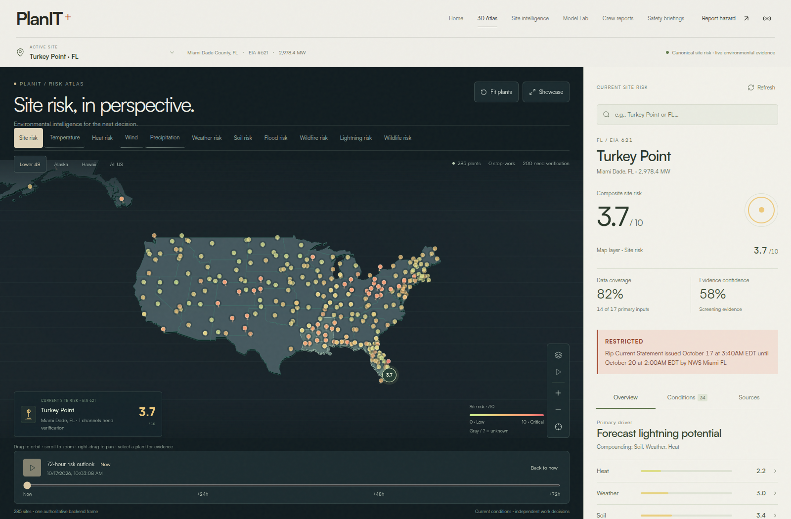
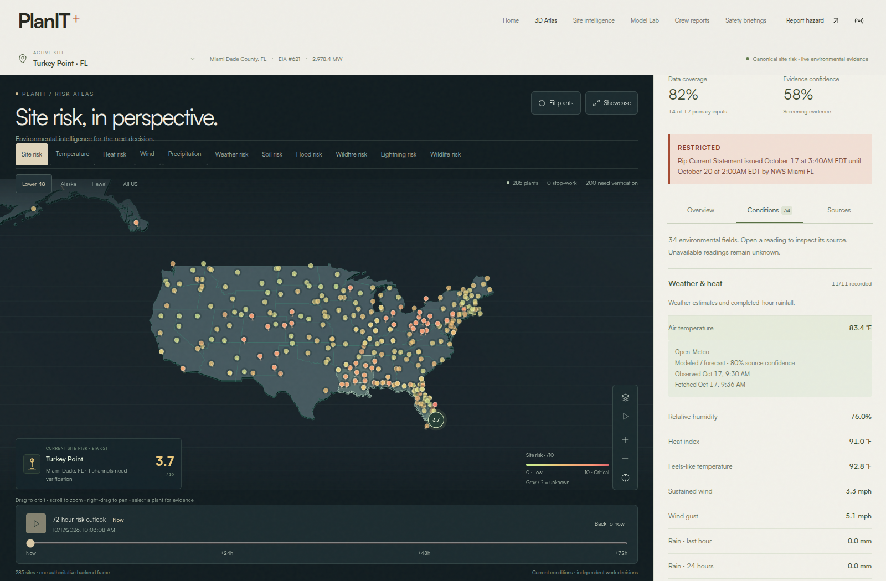
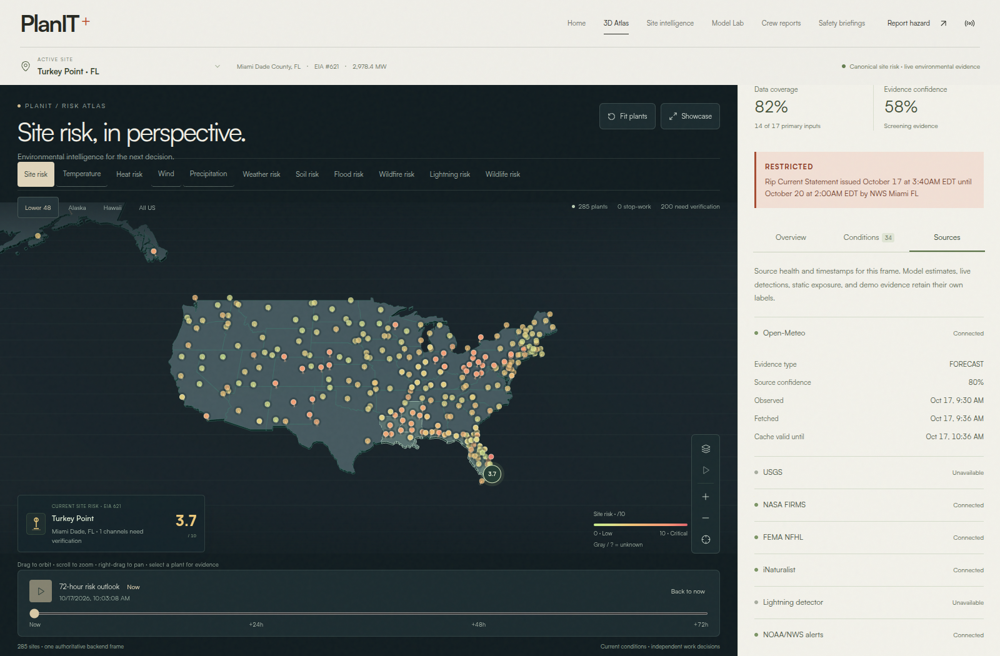
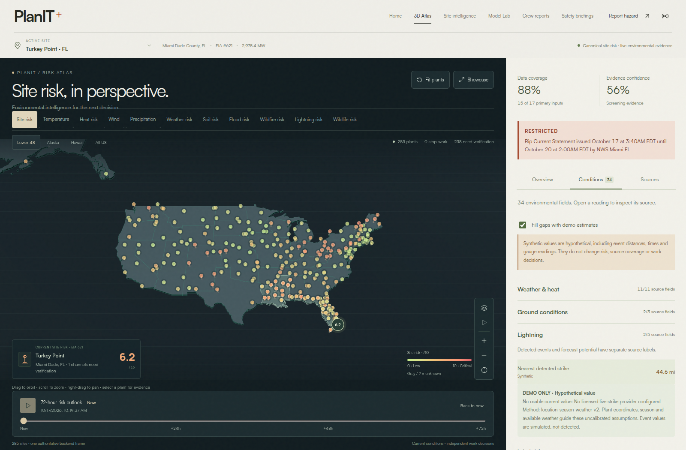

# Supervisor UI audit

Historical panel-layout audit from October 17, 2026. The [immersive atlas audit](immersive-atlas.md) covers the subsequent full-screen redesign. This iteration keeps the existing paper, charcoal and Satoshi visual identity while giving the national map and its evidence separate space.

## What changed

The desktop atlas now has a dedicated Three.js viewport beside a scrollable evidence panel. Compact plant markers expand on selection, hover or keyboard focus. The inspector keeps composite risk, the selected map measurement, coverage, confidence and independent work restrictions visible as separate concepts.

Three views organize the expanded record:

| View | Content |
| --- | --- |
| Overview | Seven scored channels, structured drivers, task decisions, active policy overrides and a three-site priority preview |
| Conditions | All 34 environmental fields, grouped into weather/heat, soil, lightning, flood, fire and wildlife; each reading opens its source metadata |
| Sources | Provider status, evidence mode, confidence and timestamps; HeatCast/GroundCast availability; plant identity, capacity, coordinates, utility and catalog date |

Site intelligence reuses the observation and source components in a labeled current-evidence section. Historical model and replay sections keep their separate time context. Mobile places the full inspector below the map and timeline in normal page flow. Layer controls scroll horizontally within their own toolbar.

The display reads the canonical backend frame. It does not recalculate risk or request a separate weather truth. Missing fields say **Unknown**, measured zeros remain zero, and false flags say **No**. Forecast lightning potential is labeled separately from detected strikes. The subsequent completion update adds a labeled demo companion to Conditions and Site intelligence. The default-on gap-fill switch shows hypothetical values for missing fields; turning it off restores Unknown. These companions remain outside operational risk, map layers, coverage and task decisions. The screenshots below precede this switch.

## Screenshots

These captures use Chrome in headless mode with SwiftShader and reduced motion. Desktop is 1600 × 1050; mobile is 390 × 844 with a full-page capture. They read the normal local runtime’s persisted provider evidence, without injected weather or risk fixtures. Background collection was disabled for the capture to avoid unnecessary upstream requests. The screenshots establish rendering, not real-time provider connectivity or field-safety validity. Times and readings are specific to this capture.

[Full mobile screenshot](assets/supervisor-atlas-mobile.png) shows the map, timeline and complete overview inspector in page order.

## Audit findings and checks

| Area | Result |
| --- | --- |
| Desktop geometry | At 1600px, the renderer was 1180 × 562px and ended at x=1180; the 420px inspector began at x=1180. The panel did not cover the canvas. |
| Mobile layout | No document overflow at 390px. The legend, network summary and timeline occupy separate rows. Inspector content follows the map. |
| Field completeness | Unit tests match the displayed field paths against every plant’s normalized shape. Browser tests find all 34 fields and inspect provenance. |
| Unknown versus zero | Browser checks distinguish a measured 0.0mm rainfall value from unavailable rainfall; unit checks also cover false flags, fractional percentiles and negative gauge trends. |
| Interaction | Browser checks cover site selection, all eleven layers, timeline frames, unknown/low-confidence states, countdown resets, crew-report SSE updates, source views and keyboard view switching. |
| Browser errors | No JavaScript page errors were captured during the desktop/mobile manual inspection. |
| Accessibility review | Controls use native buttons/inputs/disclosures, labels and focus states. Inspector text colors were darkened after a contrast review. Evidence tabs stay visible during panel scrolling; focused controls have scroll padding. Reduced motion remains supported. |
| Three.js precision | Camera near-plane scaling and polygon offset address national-scale surface flicker; unit and actual WebGL tests cover national and close pinning ranges. |

The screenshot review caught and corrected a collapsed canvas caused by stylesheet specificity and a mobile legend overlap. The browser evidence-view test now guards against a canvas hidden underneath the desktop panel. This is a scoped review of the changed supervisor UI against the [Web Interface Guidelines](https://github.com/vercel-labs/web-interface-guidelines/blob/main/command.md), not a complete accessibility certification.

## Remaining limits

The [historical frontend audit](frontend-case-study.md) records unresolved report-dialog keyboard behavior and arbitrary-location keyboard pinning. Those workflows were preserved in this pass. Shareable URLs still retain the view rather than every selected site/layer/hour. Small operational labels need validation on actual field devices and at enlarged text settings.

A fully populated national workspace can also exceed browser localStorage capacity; live reads continue when saving fails, but that browser may lack a fresh offline copy. Screenshot checks do not establish hardware GPU performance or usability in field conditions.

See [the verification record](../tests/README.md) for exact unit, browser and build results, and [provider documentation](environment-providers.md) for source and credential limits.

## Demo completion follow-up

The completed Conditions view now fills all 34 fields with source-backed values or visibly labeled synthetic estimates. This production capture uses persisted source evidence plus the backend’s hypothetical fallback companion, without injected browser fixtures. Collection was disabled on the capture process. The inspected plant had 34 populated fields, eight synthetic fields and no captured JavaScript page errors. Operational coverage and risk remain independent of the preview.

The added browser checks validate all-plant API completion, source zero/false precedence, source-only switching, site changes, 72-hour frames and the Site intelligence preview. Unit checks compare canonical frames with and without companions to prove that hypothetical data cannot modify source risk, coverage, tasks or holds. Exact latest totals are in the [verification record](../tests/README.md).
