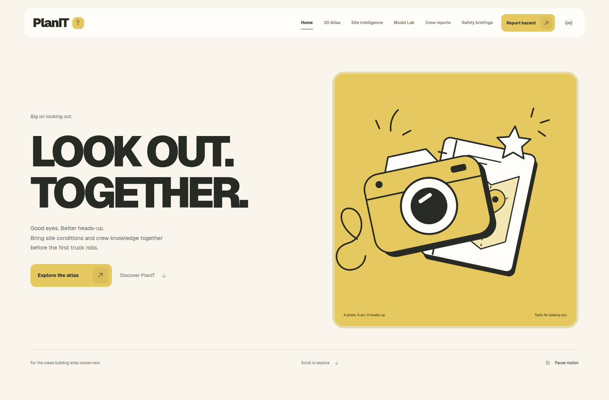
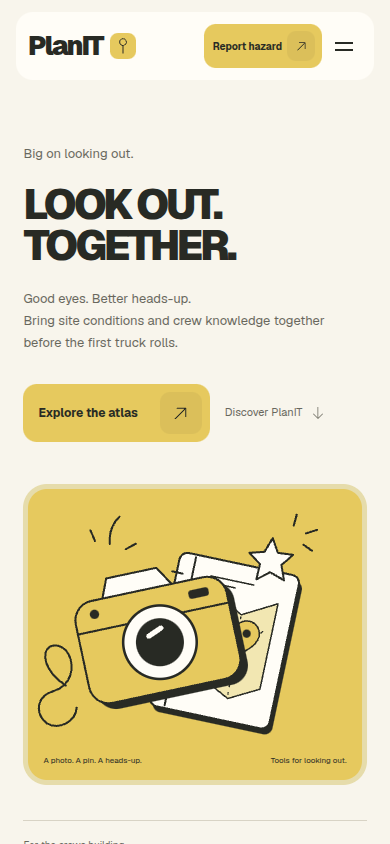
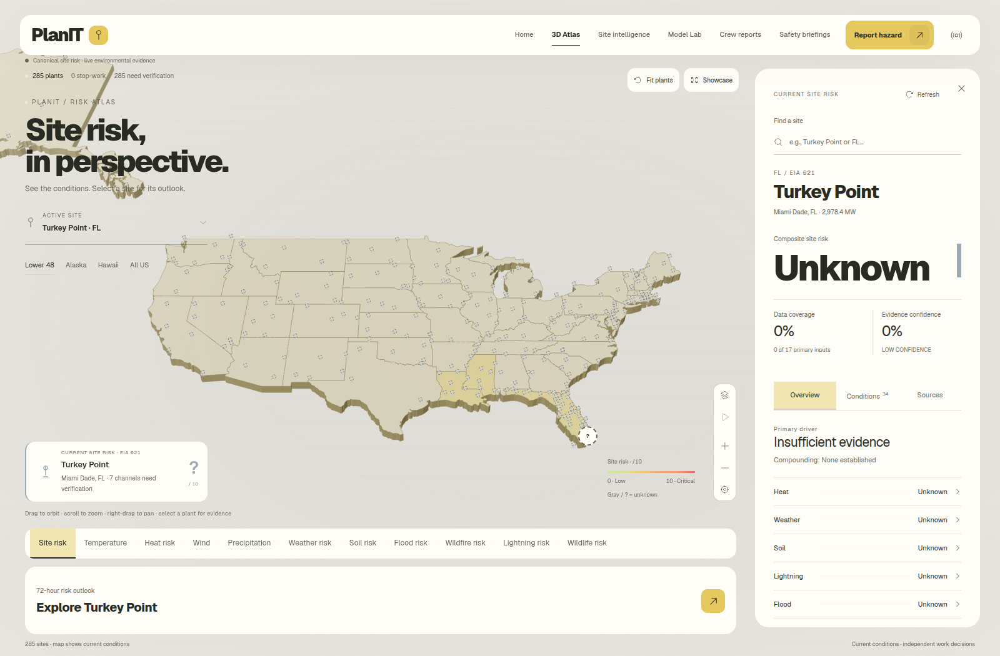
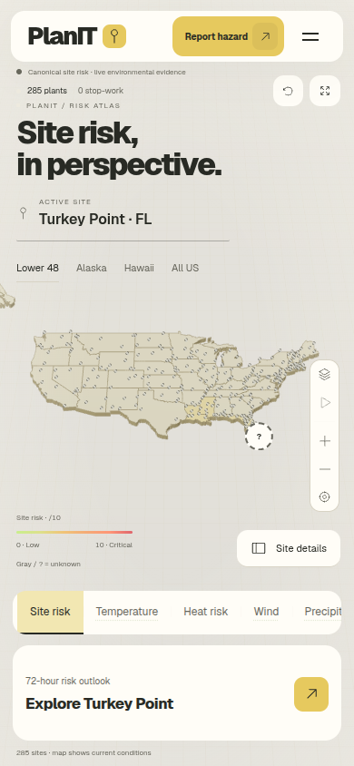
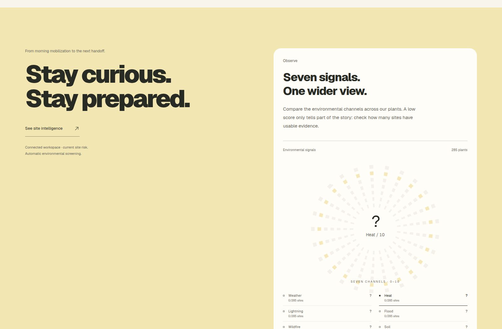
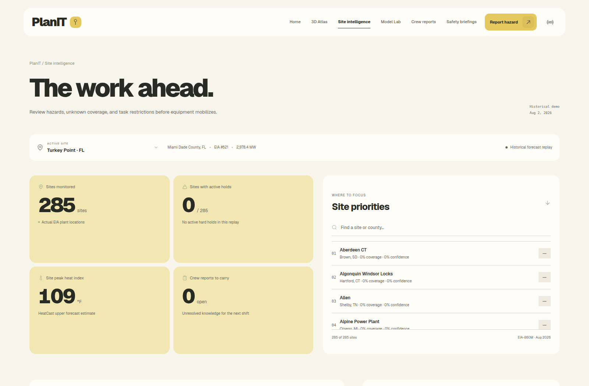

# Playful web UI

October 17, 2026. This pass carries the mobile app’s cream, butter-yellow and charcoal direction into the website. `git pull --ff-only origin main` reported already up to date before editing. Backend contracts, scoring, providers, persistence and browser transport are unchanged.

## References and direction

The requested design-taste-frontend-v1, gpt-taste and high-end-visual-design skills informed the layout, type and motion. Fresh Awwwards references were researched during the companion mobile pass; their archived images were downloaded and visually inspected. Reference images are not shipped with PlanIT.

| Reference | Design influence |
| --- | --- |
| [Good Eat’n](https://www.awwwards.com/inspiration/thumbnail-submission-63bcb5953eecc886199253) | Chunky lettering, illustrated objects and confident color blocks |
| [Pest Stop Boys](https://www.awwwards.com/sites/pest-stop-boys) | Playful graphics in a practical field-service setting |
| [Superlist](https://www.awwwards.com/sites/superlist) | Familiar objects as expressive artwork and tactile controls |

The web prompt’s Python seed was 16: an editorial split, Geist, horizontal accordion, crew-evidence carousel and marquee. The existing attention, explanation, evidence and action sequence remains. Below 768px, the homepage uses a single column.

## What changed

Locally bundled variable Geist replaces the active website typefaces. The hero and loading screen use an original SVG camera/notebook illustration; it is decorative, never an observation or crew photo. A yellow action surface, nested arrow controls and larger charcoal lettering establish the new theme across the landing page, intelligence, reports, briefings and Model Lab.

The national atlas has cream controls, a pale-gold land surface and a matching inspector. This changes scene colors and lighting only. Projection, topology, depth precision, camera limits, pin raycasting and flat-map fallback remain intact. The report pinning view keeps its dark surface. Hazard gradients, task states and unknown/low-confidence markers retain their operational meaning.

`CrewNotes` shows up to six accepted reports for the selected site. It uses actual report descriptions, authors and upload photos, with an explicit no-photo or no-reports state. Switching the selected site changes the carousel, and its report link preserves that site’s context. No testimonial, author or observation is invented.

Existing homepage environmental channels, NWS hourly outlook and task-readiness charts retain their inputs and calculations. Numbered decorative captions were removed. The atlas still consumes canonical backend snapshots; there is no new frontend scoring path or provider request.

GSAP animates the illustrated objects, image scale, article entrances, word reveals and marquee. The illustration pauses offscreen, in a hidden tab, with the global pause control and with reduced motion. Scroll effects have static reduced-motion alternatives. The service worker cache is version 10 and includes both Geist subsets for offline use. Previous font assets remain available to older shells.

## Screenshots and capture limits

The user’s existing API on port 3001 timed out on `/api/health` after three seconds. It was not restarted or modified. Production screenshots instead use a separate server on port 4188 with a temporary data directory and external collectors disabled. These images show the real bundled plant catalog, but unavailable current environmental evidence remains **unknown**. They do not demonstrate live provider connectivity or fabricate current measurements. Tests use their own isolated runtime.

| Desktop home | Phone home |
| --- | --- |
|  |  |

| Desktop atlas | Phone atlas |
| --- | --- |
|  |  |

| Environmental signals | Site intelligence |
| --- | --- |
|  |  |

## Verification

Commands ran from the repository root.

| Check | Exact result |
| --- | --- |
| `npm run build` | Passed, exit 0; TypeScript and Vite production packaging; final Vite build 5.27s |
| `npm run test:e2e -- tests/e2e/redesign.spec.ts tests/e2e/home-signals.spec.ts tests/e2e/immersive-atlas.spec.ts tests/e2e/map.spec.ts tests/e2e/workflow.spec.ts` | 16 passed, 1.9 minutes |
| `npm run test:e2e -- tests/e2e/redesign.spec.ts tests/e2e/home-signals.spec.ts tests/e2e/immersive-atlas.spec.ts tests/e2e/workflow.spec.ts --grep 'loading screen\|homepage\|demo reset\|automatic charts\|missing forecasts\|animated forecast\|fullscreen map\|models run'` | 10 passed, 59.9 seconds; includes the new selected-site crew-carousel regression |
| Responsive browser walkthrough | Home, atlas, intelligence, reports, briefings and Model Lab at 320, 768 and 1440px: 18 combinations passed; no document overflow or uncaught page errors; Geist loaded and home title stayed on two lines |
| Final breakpoint walkthrough | All six views at 744px passed after the mobile breakpoint adjustment; no overflow or uncaught page errors |
| Final production screenshot walkthrough | 1600 × 1050 and 390 × 844; zero uncaught page errors; Three.js geography reported ready |
| `git diff --check` | Passed |
| Unit tests / root lint | Unit tests were not run. The root package has no lint script; TypeScript validation ran through the build. |

Browser checks cover navigation, reduced motion and global pause, chart gaps and missing forecasts, map depth/camera/pinning and fallback, report handoff, retained lightning holds, browser calibration and offline inference. These are targeted specifications, not a claim that the entire browser suite ran. The final edits after those specifications only remove decorative chart-number prefixes, deduplicate a font-family fallback and adjust the phone breakpoint; the build and responsive capture were repeated afterward.

The existing lazy browser-ML chunk still triggers Vite’s size warning: 2,049.38 kB minified against a 1,700 kB warning threshold. Packaging succeeds; this pass does not restructure model loading. Real device touch/GPU behavior and the normal API’s health still need a separate check. No API endpoints or backend calculations changed, and the user’s SQLite history and uploads were left intact.
